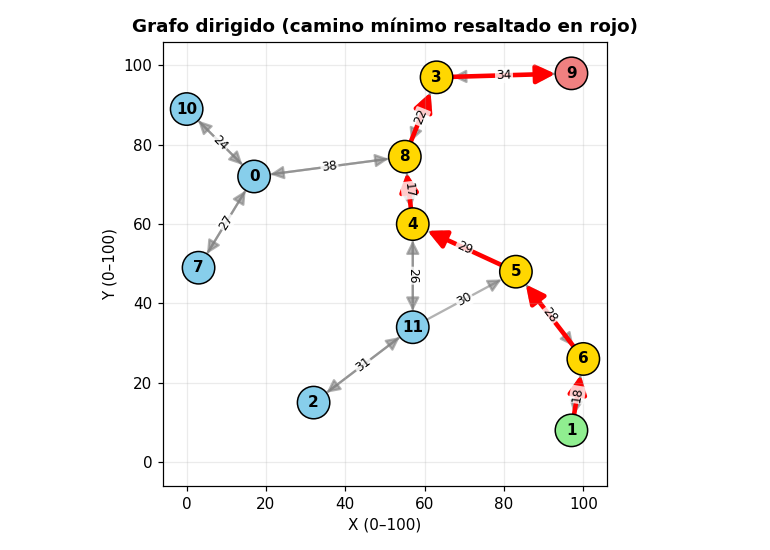

# Visualizador del algoritmo de Dijkstra

Aplicación de escritorio en Python que genera grafos dirigidos sobre un plano de coordenadas (0–100) y muestra, paso a paso, cómo el algoritmo de Dijkstra encuentra el camino de menor distancia entre dos nodos. Los pesos de las aristas son la **distancia euclidiana** entre los nodos que conectan.



*Imagen generada con la función de dibujo del proyecto (Matplotlib). El camino mínimo aparece en rojo; el origen en verde, el destino en rojo claro y los nodos intermedios en amarillo.*

## Funcionalidades

- **Interfaz gráfica** con Tkinter: controles a la izquierda, gráfico y registro del algoritmo a la derecha.
- **Coordenadas reales:** cada nodo tiene una posición (X, Y) entera entre 0 y 100, sin duplicados y con una separación mínima entre nodos. El grafo se dibuja exactamente en esas posiciones.
- **Pesos geométricos:** `peso(u, v) = √((x_v − x_u)² + (y_v − y_u)²)`. Internamente conservan toda su precisión decimal; en pantalla se muestran redondeados al entero más cercano.
- **Dos modos de generación** (de 8 a 16 nodos):
  - **Aleatorio:** conexiones por proximidad. Cada nodo se conecta con 1–3 de sus vecinos más cercanos, siempre dentro de una distancia máxima (por defecto 40), y se agregan algunas aristas extra dentro de ese mismo límite. El grafo resultante es fuertemente conexo sin añadir aristas largas; si no es posible, la aplicación lo informa.
  - **Manual:** se generan los nodos y se dibujan; luego el usuario escribe las aristas `origen destino` (una por línea, o separadas por `;` o `,`). El peso se calcula solo.
- **Edición de aristas:** el botón «Editar aristas» permite corregir las aristas de cualquier grafo (manual o aleatorio) sin perder las posiciones de los nodos.
- **Grafo dirigido:** una arista A → B no implica B → A. Los pares con ambos sentidos se rotulan con un único peso.
- **Dijkstra paso a paso:** el registro muestra cada nodo visitado, las actualizaciones de distancia y el resultado final (camino, distancia total y tiempo).
- **Visualización del camino mínimo** resaltado en rojo sobre el grafo.

## Requisitos

- **Python 3.11 o superior** (la lógica se ejecutó con Python 3.12.3).
- **Tkinter**, que forma parte de la biblioteca estándar de Python:
  - Windows y macOS (instalador de python.org): ya incluido.
  - Debian/Ubuntu: `sudo apt install python3-tk`
  - macOS con Homebrew: `brew install python-tk`
- Dependencias de `requirements.txt`: [NetworkX](https://networkx.org/) y [Matplotlib](https://matplotlib.org/).

## Instalación

```bash
git clone https://github.com/AlarmW/Algoritmo-Dijkstra.git
cd Algoritmo-Dijkstra

python -m venv .venv
# Windows (PowerShell):  .venv\Scripts\Activate.ps1
# Linux / macOS:         source .venv/bin/activate

pip install -r requirements.txt
```

## Ejecución

```bash
python dijkstra.py
```

## Uso

1. Elige el número de nodos (8–16) y el modo (**Aleatorio** o **Manual**).
2. Pulsa **Generar grafo**.
   - En modo manual se abre una ventana con las coordenadas de cada nodo, donde escribes las aristas (por ejemplo `0 1`, `1 2` o `0 1; 1 2`).
3. Para corregir las aristas en cualquier momento, pulsa **Editar aristas**. Lo que escribas reemplaza las aristas actuales.
4. Elige **origen** y **destino** y pulsa **Calcular Dijkstra**. El registro muestra el proceso y el camino mínimo queda resaltado en rojo.
5. **Mostrar grafo** redibuja el grafo sin resaltado; **Limpiar registro** vacía el registro; **Salir** cierra la aplicación.

## Configuración

Las constantes principales están al inicio de `dijkstra.py`:

| Constante | Valor por defecto | Función |
|---|---|---|
| `DIST_MAX_ARISTA` | `40.0` | Distancia euclidiana máxima de las aristas generadas automáticamente |
| `K_VECINOS_MAX` | `3` | Máximo de vecinos cercanos a los que se conecta cada nodo |
| `PROB_EXTRA` | `0.10` | Probabilidad de aristas extra (dentro del límite) |
| `DIST_MIN_NODOS` | `16` | Separación mínima entre nodos al generarlos |
| `NODE_SIZE` | `450` | Tamaño de los nodos en el dibujo |

Si el límite de distancia es demasiado bajo para el número de nodos, la generación aleatoria puede fallar y la aplicación mostrará un aviso. En ese caso, aumenta `DIST_MAX_ARISTA`.

## Limitaciones conocidas

- Entre 8 y 16 nodos; la implementación de Dijkstra es O(V²) y no está pensada para grafos grandes.
- Las aristas escritas a mano (modo manual o «Editar aristas») no se limitan por `DIST_MAX_ARISTA`; en un grafo aleatorio editado, el registro avisa de las que superan el límite.
- Si hay varios caminos de igual distancia, solo se resalta el primero.
- Con aristas muy cercanas entre sí, algunas etiquetas de peso pueden solaparse.

## Estructura del proyecto

```
.
├── dijkstra.py          # Aplicación completa (lógica, dibujo e interfaz)
├── requirements.txt     # Dependencias de Python
├── ejemplo_grafo.png    # Imagen de ejemplo usada en este README
└── README.md
```

## Autor

AlarmW — proyecto académico.

